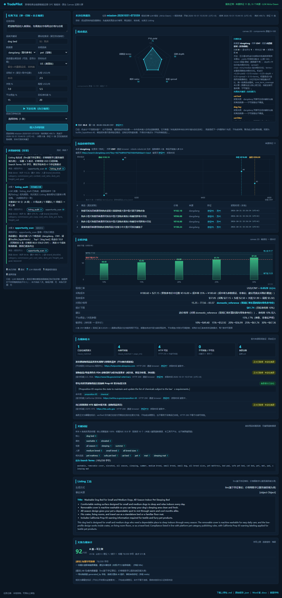

# 跨境领航员 TradePilot Global

> 跨境电商全链路智能运营平台 —— 真实数据驱动、每个数字可溯源。
> （源起：第二届全国人工智能应用创新大赛参赛作品，现按生产级可交付标准演进，
> 整合方案见 `docs/production-integration.md`）

## 一句话介绍

给跨境电商卖家的"AI 运营部"：输入一个目标（如"把宠物用品切入美国站"），
智能体自主完成 **竞品实采 → 定价沙盘 → 合规体检 → 关键词层 → Listing 工坊 → 文案合规审计** 全链路
（目标里点名"选品/赛道/机会"时，额外先跑 **选品雷达** 做多关键词真实扇描），
全程真实数据、决策可解释、结果可量化；多租户登录、用量可查、
东南亚市场（Shopee/Lazada 官方 API 层）已接入协议层。



> 图由 `python scripts/shot_dashboard.py` 自动生成：打开线上应用 → 回放最新一条真实存档 → 整页截图。
> 手工截图必然过期（界面加过「本步耗时」「抓取通道」「外部复核」等字段），所以把生成方式固化了。

## 三条红线（信任底座）

1. **真实数据**：价格来自公开页真实抓取（Playwright 无头浏览器），每个数据点带
   来源 URL + 抓取时间戳 + 内容 hash 存证（SQLite）；解析不出真实数据就报错，绝不编造。
   存证 URL 用**单品详情页**而非搜索页，前端点"存证#N"弹层显示时间戳 + 原文片段 + 回访链接
   （`/api/provenance/{id}`）。抓取前过 **robots.txt 闸门**——声明"尊重 robots"就必须有代码拦着（`fetch.robots_allowed`）。
2. **来源闸门**：定价/Listing 等下游工具只允许消费存证在册的数据点（`provenance_id` 过闸），
   编造的 id 一律拦截（held）。
3. **诚实口径**：规则性知识（合规清单、平台佣金）与抓取事实分列标注。合规条款分三档如实标：
   **官方页正文命中**（附命中片段）/ **仅域名可达**（灰标）/ **未命中**——绝不把"HTTP 200"说成"条款已验证"；
   量化结论一律"以 X 代价换 Y 收益"框架，禁"显著提升"类无口径表述。
   "命中"的判定还要求片段**读得懂**：只接受通过正文判定（12–90 词、非页脚、非 Title Case 堆砌）的句子，
   导航栏里出现条款词不算验证——实测不加这条，FDA/OEHHA/USITC 的"证据"会全是
   "Careers · Contact Us · Listserv" 这类页脚文字。

## 自主性怎么实现的（可审计，不是口号）

下一步**由当前状态决定**，不是由写死的顺序决定（`app/planner.py`）：

- **依赖图 + 候选打分**：所有硬依赖已满足的工具都是候选；评分 = 基础先验 + 目标路由
  （目标里点名"合规/定价/listing"就优先该环节）+ 事实面就绪加成 − 缺口惩罚；
- **LLM 真实决策**：模型在**可执行候选白名单**内选择，选中即采纳；与规则评分不一致时
  以模型为准并记录分歧（`llm_overrides`），不再只是给规则序盖章；
- **失败自主纠偏**：产出不足 → 换参重试（如切换数据源）；重试耗尽 → 依赖它的步骤
  降级跳过，独立分支继续跑完，任务降级但不中断；
- **决策卡可审计**：每张卡记录候选集、得分、"为什么没选别人"、闸门结果与耗时。

> 口径提醒：`llm_decisions`（模型做出选择的步数）不等于自主性证据，
> **`llm_overrides`（模型选择与规则评分不一致且被采纳）**才是。

## 系统组成

```
app/
├── main.py               FastAPI + WebSocket 遥测 + 任务存档/导出 + 租户配额中间件
├── planner.py            自主规划器（依赖图 + 候选打分 + 重试/降级）
├── orchestrator.py       执行循环：规划 → 接线 → 执行 → 决策卡实录
├── provenance.py         来源存证库（SQLite；数据信任层，全局事实库）
├── store.py              任务存档（JSON，按租户隔离）+ 上架包导出
├── auth.py               argon2id + JWT + 刷新令牌轮换 + 多租户
├── quota.py              租户每日 LLM 配额（按请求权重扣减）
├── usage.py              LLM token 用量计量（计费原料，按租户归属）
├── request_context.py    请求级租户上下文（ContextVar → 深层链路）
├── monitoring.py         进程内指标 + 告警（/api/metrics）
├── shops.py              店铺授权归属（哪个店铺是谁授权的——多租户闸门数据源）
├── export_docx.py        上架包 DOCX 导出（标准库手写 OOXML，不引第三方库）
├── config.py             全环境变量配置（Key 不入库；数据目录自动回退 /tmp）
├── llm.py                LLM 网关（书生 InternAI / 阶跃；无 Key 优雅降级）
├── agents/               产品层 Agent：市场洞察/选品/文案/合规/客服/全链路
├── datasources/          Shopee/Lazada 开放平台客户端（签名 + 诚实信封判定）
└── tools/
    ├── executor.py       统一执行器 + 工具白名单 + 来源闸门
    ├── fetch.py          双通道抓取 + robots 闸门 + Chromium 复用
    ├── opportunity.py    选品雷达（多关键词真实扇描 → 样本观测机会分）
    ├── competitor.py     竞品实采（真实解析 + 无关结果过滤）
    ├── pricing.py        定价沙盘（确定性计算 + 三分支定价建议）
    ├── compliance.py     合规体检（官方来源 + 条款正文命中定位）
    ├── keywords.py       关键词层（真实竞品标题词频 → 中英映射 → Search Terms）
    ├── listing.py        Listing 工坊（LLM 组织文案 / 合规骨架，事实回填）
    └── listing_audit.py  文案合规审计（字符上限/违禁宣称/堆砌/A9 基础）
web/                      岸基运营大屏（原生 Canvas，/canvas 独立路由）
web-react/                主前端（React 18 + Vite + TS + Tailwind，/app 路由）
scripts/                  运维工具（Postgres 迁移导出、部署、截图等）
tests/                    621 个用例（解析器/闸门/定价/规划器/审计/清洗/关键词/雷达/导出/评测口径/
                          认证/租户隔离/开放平台客户端/店铺授权与调用网关/配额/用量/监控/运营后台/看板趋势/
                          密钥清理红线/Shopify 联调编排/生产就绪门禁）
```

## 快速开始

```bash
pip install -r requirements.txt
python -m playwright install chromium
uvicorn app.main:app --host 127.0.0.1 --port 8080
# 主前端 http://127.0.0.1:8080/app（注册即建租户，内测免费）
# 运维大屏 http://127.0.0.1:8080/canvas
```

前端开发模式：

```bash
cd web-react && npm ci && npm run dev
```

可选增强（LLM 规划与 Listing 文案）：

```bash
# 默认网关：书生 InternAI 聚合（https://discovery-api.intern-ai.org.cn/v1）
# 默认模型：Atria-Dawn；Key 读取顺序：环境变量 LLM_API_KEY > tradepilot/.llm_key 文件
# 阶跃 step_plan 作为备选：LLM_BASE_URL=https://api.stepfun.com/step_plan/v1
set LLM_MODEL=Atria-Dawn
```

无 Key 时自动走规则规划，功能不缺、口径不变。

**魔搭创空间线上接入 LLM**（Secret 是运行时注入，改完需重新部署才生效）：
创空间 → 设置 → 环境变量 → 新增私密 Secret `LLM_API_KEY`（值即网关 key，无需 base_url
和 model——走代码默认）。重启空间后 `/api/health` 返回 `"llm": true` 即生效；客服回复
标 `generated_by="llm"`、`/api/metrics` 的 `llm_usage_today` 开始计 token。换网关时同
处改 `LLM_BASE_URL` + `LLM_MODEL`（已实测备选见 `docs/llm-gateways.md`）。

## 常用环境变量

| 变量 | 作用 | 默认 |
|---|---|---|
| `TRADEPILOT_DATA_DIR` | 存证库与任务存档目录 | 系统临时目录 `tradepilot/`（**不在仓库内**——放仓库里会随部署一起上传） |
| `TRADEPILOT_DISABLE_LLM` | 置 1 强制规则模式（评测复现、离线演示） | 关 |
| `TRADEPILOT_RESPECT_ROBOTS` | robots.txt 闸门 | 开 |
| `TRADEPILOT_CHROMIUM` | 指定 Chromium 可执行文件（容器内系统浏览器） | 自动探测 |
| `TRADEPILOT_MARKETPLACE` | 默认目标站点（US/UK/DE/JP） | US |
| `TRADEPILOT_ADS_REPORT` | 广告搜索词报告 CSV 路径；配置后关键词层挂真实曝光/点击 | 空（降级为代理指标） |
| `TRADEPILOT_ADS_PERIOD` | 报告覆盖周期（如 `2026-10-01~2026-10-31`），无区间则曝光量不可解释 | 空 |
| `TRADEPILOT_LISTINGGOOD` | 外部合规复核模式：`off`/`check`（免费浅检）/`deep`（计费深度体检） | `off` |
| `LISTINGGOOD_API_KEY` | 外部复核密钥；也可放 `tradepilot/.listinggood_key`（已 gitignore） | 空 |
| `TRADEPILOT_JWT_SECRET` | JWT 密钥（多实例必须显式配；单机自动生成持久化） | 自动 |
| `TRADEPILOT_TENANT_DAILY_LLM_LIMIT` | 每租户每日 LLM 配额（请求权重），0 = 关闭 | 100 |
| `TRADEPILOT_ADMIN_TOKEN` | 运营后台令牌（`/api/admin/*`）；未配置 = 后台关闭 | 空（关闭） |
| `SHOPEE_PARTNER_ID` / `SHOPEE_PARTNER_KEY` | Shopee 开放平台凭证（`.env.local`，未配置如实报未接入） | 空 |
| `LAZADA_APP_KEY` / `LAZADA_APP_SECRET` | Lazada 开放平台凭证（同上） | 空 |
| `PORT` | 监听端口（Cloud Run 运行时注入；镜像默认 7860 = 魔搭健康检查端口） | 7860 |

## 任务流（规划图 8 个工具；标准任务执行 8 步 = 8 张决策卡 + 一份可溯源上架包）

| 决策 | 工具 | 产出 |
|---|---|---|
| 0 | /opportunity_scan | 选品雷达：多关键词真实扇描 → 候选品类调研先后（口径 = 本批真实样本观测，**不是需求量**）。每轮都会执行、但不抢占首步（约 35s）；目标点名"选品/赛道/机会"时提前到最前 |
| 1 | /market_scan | 真实竞品卡（价格带 min/median/max，剔除无关结果，全部带存证） |
| 2 | /fx_rate | 现场真实汇率（存证后供折算，拒绝内嵌汇率） |
| 3 | /pricing_sandbox | 到岸成本分解、报价下限、5 档净利率敏感性、三分支定价建议（成本率假设可调） |
| 4 | /compliance_check | 品类合规清单，逐条回官方页**定位条款正文片段**（FDA/CPSC/OEHHA/HTS…）；HTTP 被 WAF 拦（403/空壳）自动降级浏览器通道；抓不到正文只标"可达"，不标"已验证" |
| 5 | /keyword_plan | 真实竞品标题词频 → 核心/属性/场景/人群/相关品类 → Search Terms |
| 6 | /listing_draft | 英文标题+5 卖点（LLM 组织 / 合规骨架，数字服务端回填）；**语言硬约束**：目标站 US/UK 出现中文字符即判不合格 → 带原因重试一次 → 仍不合格退回合规骨架（`generated_by` 写明原因） |
| 7 | /listing_audit | 文案审计：字符上限、违禁宣称、堆砌、A9 基础、占位符未填（纯函数、可复算）；可选叠加第三方复核，见下节 |

## 外部复核：接进来当"第二意见"，不当权威

`listing_audit` 可以额外调一次第三方合规服务（ListingGood），但**默认关闭**，
且它的结论**不参与本地评分**。这么定不是保守，是实测后的结论：

| 实测发现 | 后果 |
|---|---|
| 浅检规则引擎把 `stops sliding` 的 `stops` 判成"医疗健康宣称 high"，`BPA free` 在同一次报告里重复计两遍 | 拿它当闸门会把合格文案拦下来 |
| 深度体检按次计费、走异步任务（实测 21.7s），依赖外部服务可用性 | 评测批量跑会烧额度；现场断网作品就没了 |
| 本地规则审计是纯函数：同样输入必然同样输出，可离线复算 | 这才是能交付、能答辩复现的那一层 |

所以两者**并排展示分歧，不取平均**——两个引擎方法不同（确定性词表+字符上限 vs
LLM 语义+知识库），平均出来的数没有物理意义，还会把"两边都没把握"伪装成"两边都同意"。

实测的一处分歧（可复现）：

```
本地规则审计  80 分 → 可上架
外部复核      75 分 → Needs attention，1 项高危：医疗健康宣称「stops」
交叉校验      divergent，external_only=1
```

人一眼能看出 `stops` 是误报——**证据原文必须并排给出来**，否则使用者无法判断。
反过来，深度体检也抓到了本地规则抓不到的东西：`keeps water cooler for longer`
这类**无量化支撑的比较级宣称**（本地词表只认 `best/cures` 这类硬词）。两个都会错，
所以谁都不能单独当裁判。

联调脚本（真实 Key、一次性）：

```bash
TRADEPILOT_LISTINGGOOD=check python scripts/check_listinggood.py   # 免费浅检
TRADEPILOT_LISTINGGOOD=deep  python scripts/check_listinggood.py --deep  # 扣额度
```

`off` 模式下审计结论与未接入时**逐字节一致**（`tests/test_listinggood.py` 有用例守着）；
外部服务挂掉只会在导出物里留一行"未取得结果，本地审计结论不受影响"，不会中断任务。

## 关键词层：为什么不给"月搜索量"

这一层最容易造假——凭空写"月搜索量 12,000"最省事，也最容易被一戳就破。所以边界是：

- **给能复算的**：某词在 N 条真实竞品标题里出现 M 次，附证据标题，可回访原页核对；
- **给能代替的**：竞争度用**代理指标**——核心词覆盖率、标题均长、观测词数，全部来自真实样本；
- **不给拿不到的**：搜索量、竞争度评分一律不输出（`tests/test_keywords.py` 有用例守着）；
- **一条界线**：观测词描述的是"买家在搜什么 / 竞品在写什么"，**不等于"本品有什么参数"**，
  所以标题骨架只放核心词 + 待填占位符，属性词单列为"需与本品实际一致"。

**数据源可插拔**（[`docs/keyword-data-sources.md`](docs/keyword-data-sources.md)）：
广告搜索词报告（不需要商标、API 免费）是门槛最低的真实数据源，适配器已就位
（`app/datasources/ads_report.py`）——报告配置了就挂真实曝光/点击/订单，
没配置就标注 `not_configured` 并降级到代理指标，**不报错也不猜数**。
Brand Analytics 需要商标（¥3k–8k、6–12 个月），参赛阶段不划算，已在文档里写明取舍。

## 评测：两个只能由真人产出的维度

`assets/eval_results.json` 里 `human_baseline` 与 `fact_spot_check_accuracy` 恒为 null，
不是脚本缺陷，是红线要求（agent 自检不自证）。为了让真人真的做得动，提供一条命令：

```bash
python scripts/human_baseline.py status                     # 看两项进度
python scripts/human_baseline.py timing --name 张三 --hourly-cny 80   # 按 SOP 五阶段掐表
python scripts/human_baseline.py spotcheck --limit 10       # 逐条回访存证，算事实准确率
```

工具本身不提供任何默认值：非 TTY 直接拒绝（防止脚本代跑）、Ctrl+C 不留半截基线、
跳过保持 null（准确率不会因为"跳过 4 条"变成 100%）。
成本折算的 agent 侧取**单次任务均值**，与人工单次同口径——用整批 wall time 去比
会把 N 次任务的耗时压在 1 次人工任务上，自动化率凭空变好看。

## 数据源与检索词

### 当前源表与可达性（如实分列，不合并口径）

| 源 | 币种 | 本机可达性 | 用途 |
|---|---|---|---|
| `dangdang` | CNY | ✅ 可抓（实测） | 国内参考价；`band_source = domestic_reference`（÷真实汇率折算），**不称为"美国站竞品价"** |
| `newegg` | USD | ✅ 可抓（实测 12 SKU，存证为单品页 URL） | 海外真实竞品价与美元价格带主源 |
| `walmart` | USD | ❌ 被自家 robots.txt 拦（2026-10-30 实测对通用 UA 禁止 `/search`） | parser 保留；`TRADEPILOT_RESPECT_ROBOTS=0` 不做绕过，故默认不参与，改用官方 API 授权后才升级为 `us_retail` |

- 源可达性证据见 [`docs/sources-audit.md`](docs/sources-audit.md)；抓不到就如实报错，不为凑数换源或合成。

### 检索词：一个真实踩过的坑

英文品类词直接搜中文站会命中同名图书：搜 `dog bed` 返回绘本《The Dog on the Bed》，
搜 `狗窝` 返回《童年的狗窝》——价格带会被书籍彻底污染。所以：

- **检索词本地化**：中文源自动把英文品类词映射为中文词（`dog bed → 狗床`），
  可用任务参数 `keyword_cn` 覆盖；
- **两层品类相关性**：品类主名词命中 + 排除词表（"充电"不再让剃须刀混进 `usb c cable` 样本），
  跨语言别名单独一层兜底；
- **三层清洗**：书籍标记/ISBN → 品类相关性词 → 同名同价去重，剔除条数如实上报；
- **不做的事**：不为了凑数保留无关条目，样本不足 3 条直接报错。

### 抓取通道：HTTP 优先，被 WAF 拦就换浏览器

实测美国官方站对 HTTP 直连普遍不友好：CPSC/FCC/PHMSA 返 **403 Access Denied**、
`hts.usitc.gov` 是 JS 单页应用（正文 0 字）、`oehha.ca.gov` 命中 Incapsula 拦截页。
同一批 URL 走 Chromium 全部 200 且有正文。因此合规体检按两段式取数：

| 场景 | 行为 |
|---|---|
| HTTP 200 且正文可核验 | 直接用，`channel = http`（快） |
| HTTP 403 / 空壳 / 拦截页 | 自动降级浏览器再试一次，`channel = browser` |
| 两条通道都失败 | 如实报 `blocked`，并同时给出两条通道的失败原因 |
| robots 禁止 | 两条通道都不发起请求，直接 `robots 禁止` |

入口页一旦证实需要浏览器，同域深页直接走浏览器，不再逐条撞 403。
每个条款的 `channel` 字段都进存证，答辩被问"怎么抓的"直接给这个值。

## 接口

核心端点（完整清单以 `app/main.py` 路由为准）：

| 方法 | 路径 | 说明 |
|---|---|---|
| GET | `/api/health` | 健康检查（含存证条数、数据目录、LLM 状态） |
| GET | `/api/tools` | 工具白名单与说明（8 个） |
| GET | `/api/capabilities` | 能力声明——首页数字必须能在这里对上 |
| WS | `/ws/mission` | 下达任务，流式回推决策卡与最终报告 |
| GET | `/api/missions` | 历史任务列表（登录后只见本租户的） |
| GET | `/api/missions/{id}` | 任务原始报告（跨租户与不存在同回 404） |
| GET | `/api/missions/{id}/export?format=md\|json\|docx\|opc` | 导出上架包 / 原始报告 / OPC「想法→生意」简报 |
| GET | `/api/opc/brief` | 最新一次任务的 OPC「想法→生意」价值链简报（JSON，现场讲命题用；无归档任务 404） |
| GET | `/api/provenance/{id}` | 单条存证详情（URL / 抓取时间戳 / 内容 hash / 原文片段） |
| GET | `/api/provenance` | 存证清单（`?kind=&limit=`，上限 200）——现场随机回访与事实抽检用 |
| POST | `/api/auth/register` · `/login` · `/refresh` · `/logout` | 多租户认证（argon2id + JWT + 刷新轮换） |
| GET | `/api/me/usage` | 租户自查：配额余额 + 本人 token 明细 |
| GET | `/api/metrics` | 进程内指标（路由归一、只算 5xx 为错误） |
| GET | `/api/admin/overview` · `/admin/trends` | 运营后台（`X-Admin-Token`；未配置令牌 = 关闭） |
| GET | `/api/integrations/{platform}/auth-url` | 店铺授权链接（未配凭证 409，与 404 分开） |
| POST | `/api/integrations/{platform}/exchange` | 授权 code 换店铺令牌（成功即落租户归属） |
| GET | `/api/integrations/{platform}/shops` | 本租户已授权店铺清单（`token_alive` 如实） |
| POST | `/api/integrations/{platform}/shops/{shop_id}/call` | 店铺级调用网关（授权闸门 + 业务白名单） |

## 测试

```bash
python -m pytest tests -q      # → 621 passed（全离线：不联网、不污染生产存证库）
python scripts/production_gate.py check   # 8 项生产就绪门禁；未验证项如实 FAIL，不估算
```

覆盖：解析器 / 来源闸门 / 定价 / 规划器与自主性指标 / 文案审计 / 检索词清洗 /
关键词口径 / 广告报告适配器（合计行剔除、不猜表头、不造搜索量）/ 合规双通道降级与证据可读性 / 文案语言与结构约束 / 人工维度录入
（分钟不可取整、跳过保持 null、单次口径）/ 选品雷达 / DOCX 导出 /
合规条款命中判定 / 评测口径（可溯率、抽检、人工成本折算）/
认证与租户隔离 / 开放平台客户端（两家签名与信封差异）/ 店铺授权归属与调用网关闸门 /
配额扣减与回滚 / token 用量计量 / 监控告警 / 运营后台 / 看板趋势补零 /
Postgres 迁移导出自检 / 集成端点（401/404/409/502 语义分层）。

### 生产就绪门禁（交付前必跑）

`scripts/production_gate.py` 把"能不能对外称生产级"拆成 8 项：测试与构建、
GitHub CI、分支同源、无明文凭证、真实平台联调、人工评测实数、定价决策、文档无漂移。
可自动采集的字段由 `collect` 刷新；测试/CI 只认证测值，**门禁不代填、不估算**：

```bash
python scripts/production_gate.py collect   # 刷新 git/评测/密钥/联调/定价/忽略规则
python scripts/production_gate.py check     # 8/8 才退出 0，否则逐项列出阻塞
```

人工基线、30 点抽检、真实 token、运营定价、网关吊销这五项按红线只能由本人完成，
门禁会如实 FAIL，直到证据文件反映真实结果。

## 部署

- Google Cloud Run：见 [`docs/gcp-deploy.md`](docs/gcp-deploy.md)（PORT 注入、只读文件系统、持久化三种方案与取舍）
- 魔搭创空间：镜像默认端口即 7860（与魔搭健康检查端口一致），无需显式设置任何环境变量
- 本地 Compose：`PORT=18081 docker compose -p tp-verify up -d --build`；两侧端口统一由 `PORT` 控制（默认 8080），无 `.env.local` 也能起，LLM 如实离线

### 发布面门禁（部署后必跑）

材料写"8 工具 / 原生 Canvas / 每个数字可点溯源"，而公网链接可能悄悄跑着上周的镜像——
评委点开链接看到的与 BP 不一致，比代码有 bug 更致命。所以把它做成脚本拦住：

```bash
python scripts/check_release_drift.py            # 只读 GET，比对线上 vs 本地代码，漂移即 exit 1
python scripts/build_bp.py --check-live          # 生成 BP 前先过同一道门禁，不过就不出 PDF
```

**发布地址只写在 `scripts/release_info.py` 一处**，BP / 演示视频 / 云端验证 / 漂移检查
全部从这里取。这不是洁癖：地址原先硬编码在四个脚本里，2026-10-31 换部署后漏改，
BP 里印着已经 403 的旧链接——评委点开就是死链。现在地址变了只改一行。

发布出来的应用带分享码，接口不带一律 403，所以 `release_info` 也负责把
`?sharecode=...` 拼到每个请求上；换环境用 `TRADEPILOT_SHARE_URL` 覆盖，不改代码。

### 部署步骤（上传目录要先清干净）

发布部署会把**整个项目目录**打包上传，只排除 `node_modules` / `.git` / 构建产物。
而运行态数据默认在系统临时目录（不在仓库内），所以正常情况不需要额外操作。
但如果曾经把 `TRADEPILOT_DATA_DIR` 指向过 `assets/`，或者要连凭证一起控制：

```bash
python scripts/deploy_clean.py status                 # 看会不会把数据/凭证传上去
python scripts/deploy_clean.py stash --keys .listinggood_key   # 部署前移出
# …部署…
python scripts/deploy_clean.py restore                # 部署后移回，本地开发照旧
```

`stash` 只动运行态数据和你点名的凭证，**不动 `.llm_key`**（除非你点名）——
线上要不要跑 LLM 模式由你决定，脚本不替你决定。

## 免责说明

竞品价格与页面内容来自公开网页抓取，仅用于市场调研演示；合规清单与文案审计规则的**条目本身**
是编辑性知识，系统只对其官方来源做"正文命中 / 仅可达 / 未命中"三档核验，不构成法律意见。
平台费率、关税等以参数形式提供，可按实际站点调整。robots.txt 禁止抓取的站点不做绕过
（因此 Walmart 当前不参与抓取，美国站竞品价以 Newegg 真实 USD 样本为源）。

---

## 生产整合状态（M1-M4，详见 docs/production-integration.md）

| 里程碑 | 内容 | 状态 |
|---|---|---|
| M1 | 产品层 Agent 迁入并接真实工具层；模拟数据下线为 sample 并强制标注 | ✅ |
| M2 | React 主前端 + 5 Agent 全链路（SSE 真进度）+ 9 语种 Listing + 合规库合并 + Canvas 大屏独立路由 | ✅ |
| M3 | 认证（argon2id + JWT + 刷新令牌轮换）、租户隔离、Shopee/Lazada HTTP 客户端、CI、监控、Postgres 迁移工具包 | ✅ |
| M4 | 租户 LLM 配额、运营后台、数据看板、token 用量计量、店铺授权归属 + 调用网关 + 店铺集成页 | ✅ |

**待环境联调 / 本人决策**（步骤与脚本均已备好，门禁如实判 FAIL）：

1. Shopify：Partners 建开发店取 `shpat_` token → 写 `.env.local` → `python scripts/verify_shopify.py`
   （成功后自动写脱敏结论 `assets/shopify_verify_result.json` 供门禁 G5 读取）。
2. Shopee/Lazada 真实凭证联调；MockTransport 只证明"我们发什么、怎么判成败"，
   不证明平台服务端接受签名——那必须用真实凭证跑一次。
3. 人工基线掐表 + 30 点事实抽检（禁估算，脚本 `human_baseline.py` 已就位）。
4. 定价决策：复制 `config/pricing.example.json` 为 `config/pricing.json` 填真实价格。
5. 网关吊销 `.llm_key` / `.listinggood_key` 后，跑
   `python scripts/retire_keys.py --revoked --apply` 删除本地明文实体
   （无 `--revoked`/`--owner-decided` 一律拒绝；后者用于业主评估后决定不吊销的
   免费测试 Key，日志如实区分两种删除路径）。

**已真实验证**（2026-11-01）：Postgres 16 容器装载（DDL + 真实数据
159 行 + 序列接续，见 4.11）；Docker 多阶段镜像构建 + 容器冒烟
（health / /app 前端 / 注册全通过——并借此抓出 requirements 漏依赖与
lifespan 漏 auth 初始化两个只有干净环境才暴露的 bug）。

## 两条主线的数据口径

- **美国站**：公开页真实抓取（Playwright），逐条存证可回访；
- **东南亚**：官方 Open Platform API 协议层已就绪（秒级/毫秒级时间戳、
  大写/小写签名、两家不同的成功信封——差异全部写进模块 docstring 与测试），
  未配置凭证时如实报"未接入"，不冒充已连接。
