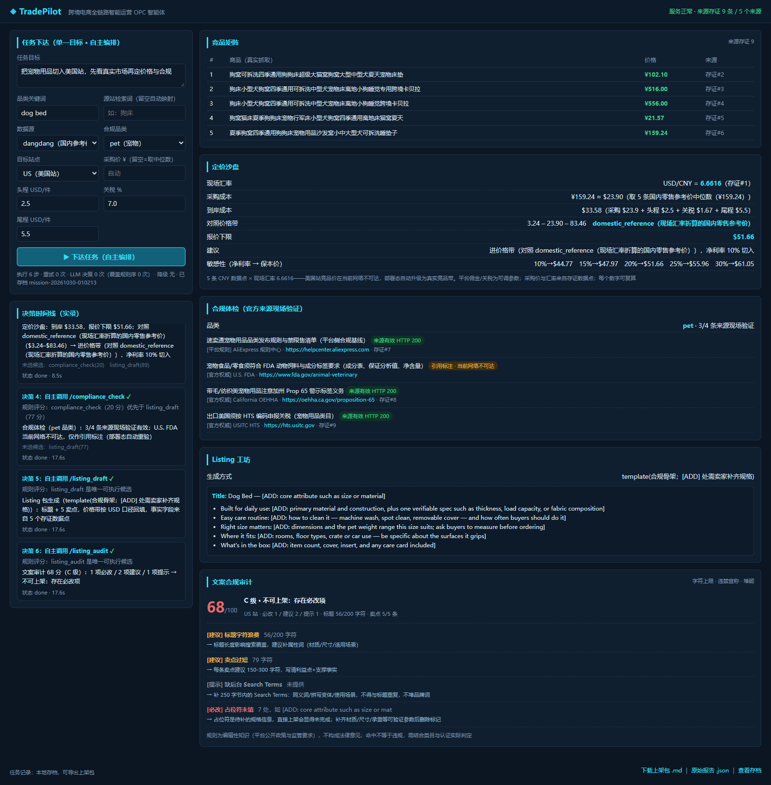

# 跨境领航员 TradePilot

> 跨境电商全链路智能运营 OPC 智能体 —— 第二届全国人工智能应用创新大赛 · 通用赛道（AI Agent 赋能千行百业 · 出海）参赛作品

## 一句话介绍

给一人公司（OPC）用的跨境电商"AI 运营部"：输入一个目标（如"把宠物用品切入美国站"），
智能体自主完成 **竞品实采 → 定价沙盘 → 合规体检 → Listing 工坊 → 文案合规审计** 全链路，
全程真实数据、决策可解释、结果可量化。



## 三条红线（信任底座）

1. **真实数据**：价格来自公开页真实抓取（Playwright 无头浏览器），每个数据点带
   来源 URL + 抓取时间戳存证（SQLite，页面可点溯源）；解析不出真实数据就报错，绝不编造。
   抓取前过 **robots.txt 闸门**——声明"尊重 robots"就必须有代码拦着（`fetch.robots_allowed`）。
2. **来源闸门**：定价/Listing 等下游工具只允许消费存证在册的数据点（`provenance_id` 过闸），
   编造的 id 一律拦截（held）。
3. **诚实口径**：规则性知识（合规清单、平台佣金）与抓取事实分列标注；
   量化结论一律"以 X 代价换 Y 收益"框架，禁"显著提升"类无口径表述。

## 自主性怎么实现的（可审计，不是口号）

下一步**由当前状态决定**，不是由写死的顺序决定（`app/planner.py`）：

- **依赖图 + 候选打分**：所有硬依赖已满足的工具都是候选；评分 = 基础先验 + 目标路由
  （目标里点名"合规/定价/listing"就优先该环节）+ 事实面就绪加成 − 缺口惩罚；
- **LLM 真实决策**：模型在**可执行候选白名单**内选择，选中即采纳；与规则评分不一致时
  以模型为准并记录分歧（`llm_overrides`），不再只是给规则序盖章；
- **失败自主纠偏**：产出不足 → 换参重试（如切换数据源）；重试耗尽 → 依赖它的步骤
  降级跳过，独立分支继续跑完，任务降级但不中断；
- **决策卡可审计**：每张卡记录候选集、得分、"为什么没选别人"、闸门结果与耗时。

> 口径提醒：`llm_decisions`（模型做出选择的步数）不等于自主性证据，
> **`llm_overrides`（模型选择与规则评分不一致且被采纳）**才是。

## 系统组成

```
app/
├── main.py               FastAPI + WebSocket 遥测 + 任务存档/导出
├── planner.py            自主规划器（依赖图 + 候选打分 + 重试/降级）
├── orchestrator.py       执行循环：规划 → 接线 → 执行 → 决策卡实录
├── provenance.py         来源存证库（SQLite）
├── store.py              任务存档（JSON）+ 上架包导出（Markdown）
├── config.py             全环境变量配置（Key 不入库；数据目录自动回退 /tmp）
├── llm.py                LLM 网关（书生 InternAI / 阶跃；无 Key 优雅降级）
└── tools/
    ├── executor.py       统一执行器 + 工具白名单 + 来源闸门
    ├── fetch.py          双通道抓取 + robots 闸门 + Chromium 复用
    ├── competitor.py     竞品实采（真实解析 + 无关结果过滤）
    ├── pricing.py        定价沙盘（确定性计算 + 三分支定价建议）
    ├── compliance.py     合规体检（官方来源知识库 + 现场可达性验证）
    ├── listing.py        Listing 工坊（LLM 组织文案 / 合规骨架，事实回填）
    └── listing_audit.py  文案合规审计（字符上限/违禁宣称/堆砌/A9 基础）
web/                      岸基运营台（原生 DOM + Canvas 风，无构建依赖）
tests/                    44 个用例（解析器/闸门/定价/规划器/审计）
```

## 快速开始

```bash
pip install -r requirements.txt
python -m playwright install chromium
uvicorn app.main:app --host 127.0.0.1 --port 8080
# 打开 http://127.0.0.1:8080
```

可选增强（LLM 规划与 Listing 文案）：

```bash
# 默认网关：书生 InternAI 聚合（https://discovery-api.intern-ai.org.cn/v1）
# 默认模型：Atria-Dawn；Key 读取顺序：环境变量 LLM_API_KEY > tradepilot/.llm_key 文件
# 阶跃 step_plan 作为备选：LLM_BASE_URL=https://api.stepfun.com/step_plan/v1
set LLM_MODEL=Atria-Dawn
```

无 Key 时自动走规则规划，功能不缺、口径不变。

## 常用环境变量

| 变量 | 作用 | 默认 |
|---|---|---|
| `TRADEPILOT_DATA_DIR` | 存证库与任务存档目录（云上设 `/tmp/tradepilot`） | 仓库 `assets/`，不可写则回退系统临时目录 |
| `TRADEPILOT_DISABLE_LLM` | 置 1 强制规则模式（评测复现、离线演示） | 关 |
| `TRADEPILOT_RESPECT_ROBOTS` | robots.txt 闸门 | 开 |
| `TRADEPILOT_CHROMIUM` | 指定 Chromium 可执行文件（容器内系统浏览器） | 自动探测 |
| `TRADEPILOT_MARKETPLACE` | 默认目标站点（US/UK/DE/JP） | US |
| `PORT` | 监听端口（Cloud Run 注入） | 8080 |

## 任务流（一次任务 = 6 张决策卡 + 一份可溯源上架包）

| 决策 | 工具 | 产出 |
|---|---|---|
| 1 | /market_scan | 真实竞品卡（价格带 min/median/max，剔除无关结果，全部带存证） |
| 2 | /fx_rate | 现场真实汇率（存证后供折算，拒绝内嵌汇率） |
| 3 | /pricing_sandbox | 到岸成本分解、报价下限、5 档净利率敏感性、三分支定价建议 |
| 4 | /compliance_check | 品类合规清单，逐条对官方来源验证可达性（FDA/CPSC/CBP…） |
| 5 | /listing_draft | 英文标题+5 卖点（LLM 组织 / 合规骨架，数字服务端回填） |
| 6 | /listing_audit | 文案审计：字符上限、违禁宣称、堆砌、A9 基础、占位符未填 |

## 数据源与检索词（一个真实踩过的坑）

英文品类词直接搜中文站会命中同名图书：搜 `dog bed` 返回绘本《The Dog on the Bed》，
搜 `狗窝` 返回《童年的狗窝》——价格带会被书籍彻底污染。所以：

- **检索词本地化**：中文源自动把英文品类词映射为中文词（`dog bed → 狗床`），
  可用任务参数 `keyword_cn` 覆盖；
- **三层清洗**：书籍标记/ISBN → 品类相关性词 → 同名同价去重，剔除条数如实上报；
- **不做的事**：不为了凑数保留无关条目，样本不足 3 条直接报错。

## 接口

| 方法 | 路径 | 说明 |
|---|---|---|
| GET | `/api/health` | 健康检查（含存证条数、数据目录、LLM 状态） |
| GET | `/api/tools` | 工具白名单与说明 |
| WS | `/ws/mission` | 下达任务，流式回推决策卡与最终报告 |
| GET | `/api/missions` | 历史任务列表 |
| GET | `/api/missions/{id}` | 任务原始报告 |
| GET | `/api/missions/{id}/export?format=md\|json` | 导出上架包 / 原始报告 |

## 测试

```bash
python -m unittest discover -s tests -t .     # 标准库即可跑，无需 pytest
```

## 部署

- Google Cloud Run：见 [`docs/gcp-deploy.md`](docs/gcp-deploy.md)（PORT 注入、只读文件系统、持久化三种方案与取舍）
- 魔搭创空间：镜像已改为读取 `PORT`，部署时设 `PORT=7860` 即可沿用原配置

## 免责说明

竞品价格与页面内容来自公开网页抓取，仅用于市场调研演示；合规清单与文案审计规则为
编辑性知识（官方来源可回访），不构成法律意见。平台费率、关税等以参数形式提供，
可按实际站点调整。robots.txt 禁止抓取的站点不做绕过。
